



 

### <code>&gt; AAHIL :: SYSTEM_CORE_ACTIVE</code>

**FRONT-END ARCHITECT &amp; WEB SYSTEMS ENGINEER**  
`// SPECIALIZATION: REACT 18 // CORE: JAVASCRIPT ES6+ // ARCHITECTURE: MODULAR UI // TESTING: JEST & RTL`

*Architecting responsive digital interfaces, scalable component hierarchies, and algorithmic cut-off engines.*

 

  
  
  
  

<!-- 01. ABOUT SYSTEM -->

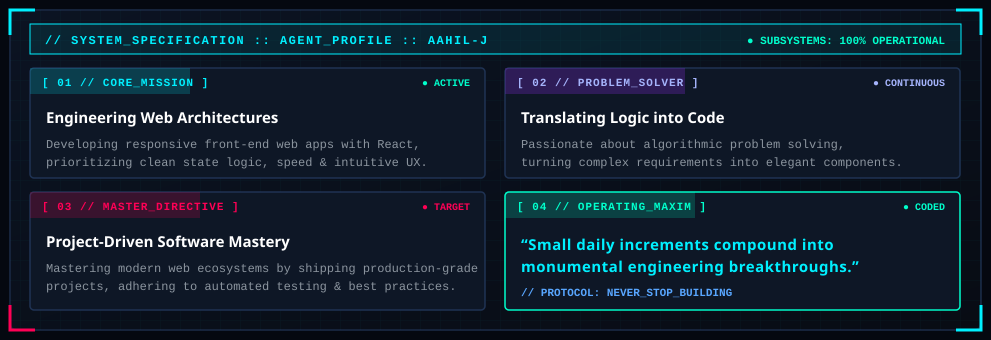

 

<!-- 02. DEPLOYED BUILDS -->

<table align="center" border="0" cellpadding="0" cellspacing="8">
  <tr>
    <td align="center" valign="top" width="50%">
      <a href="https://github.com/Aahil-J/CAF">
        
      </a>
    </td>
    <td align="center" valign="top" width="50%">
      <a href="https://github.com/Aahil-J?tab=repositories">
        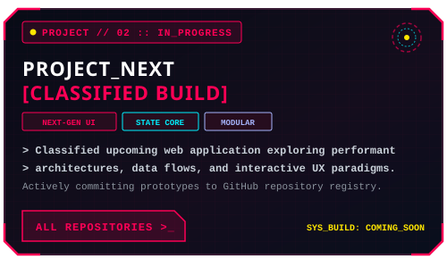
      </a>
    </td>
  </tr>
</table>

<!-- 03. CYBERNETIC ARSENAL -->

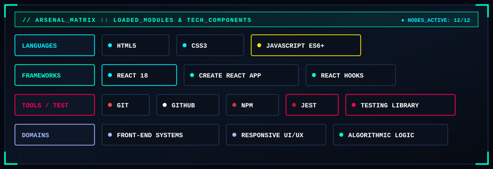

 

  
  
  
  
  
  

<!-- 04. MISSION ROADMAP -->

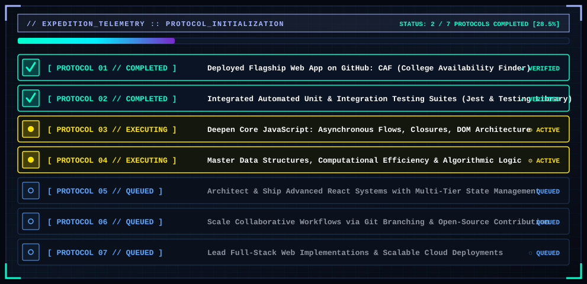

 

🛰️ <code>// DIRECTIVE: CONTINUOUS EXPEDITION :: SYSTEM GROWS PER ITERATION</code>

  

<!-- 05. ACTIVITY TELEMETRY -->

<table align="center" border="0" cellpadding="0" cellspacing="8">
  <tr>
    <td align="center" valign="middle">
      
    </td>
    <td align="center" valign="middle">
      
    </td>
  </tr>
</table>

 

  

<!-- 06. TRANSMISSION CHANNELS -->

<code>&gt; TRANSMISSION CHANNELS UNRESTRICTED. READY TO INITIATE COLLABORATIVE SEQUENCES.</code>

  

  
  
  

 

| 🛰️ **TELEMETRY FIELD** | 📡 **SYSTEM SPECIFICATION** |
|:---|:---|
| ⚡ **OPERATIONAL FOCUS** | Front-End Architecture, Responsive UI/UX Systems &amp; React Frameworks |
| 🚀 **FLAGSHIP DEPLOYMENT** | [**CAF (College Availability Finder)**](https://github.com/Aahil-J/CAF) — Cut-off scoring &amp; institutional match algorithm |
| 🛠️ **ARSENAL CORE** | JavaScript (ES6+), React 18, Jest, React Testing Library, HTML5/CSS3, Git/GitHub |
| 🌌 **NEURAL DIRECTIVE** | "Small daily increments compound into monumental engineering breakthroughs." |
| 📅 **KERNEL INITIALIZED** | Member node active since August 2026 |

  



 

### ⚡ **SESSION TERMINATION PROTOCOL COMPLETE**

*// CODE_BASE: REACT 18 // REPOSITORIES OPEN // ALL TRANSMISSIONS LOGGED*

 

[**📂 EXPLORE ALL REPOSITORIES**](https://github.com/Aahil-J?tab=repositories) &nbsp;•&nbsp; [**⚡ EXECUTE CAF BUILD**](https://github.com/Aahil-J/CAF) &nbsp;•&nbsp; [**👤 RETURN TO PROFILE**](https://github.com/Aahil-J)

